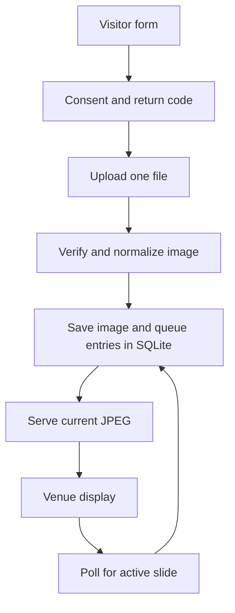

# How Guestbook works

Python keeps the backend small enough to explain in a live demo. aiohttp serves both pages and receives individual image bodies. Pillow decodes images based on their contents. SQLite keeps photo bytes and queue entries in one transaction, so a failed insert cannot leave a half-saved photo. Plain JavaScript supports a browser-equipped TV without an installed client.

| Table | Contents | Relationship |
| --- | --- | --- |
| visitor | ID, original private name, SHA-256 hash of random return code | One collection per code |
| visit | Hashed temporary-purpose upload token, consent time, successful upload count | Many visits per visitor. Tokens stay valid for this event up to their quota or deletion. |
| photo | ID, owner, normalized JPEG | Many photos per visitor |
| queue | Monotonically increasing playback ID, photo ID, nullable start time | One row per play, including replays |

## Walk through one upload

1. The form sends a name and explicit consent to `POST /api/visit`. An existing code chooses its owner. An empty code creates a new collection. Only hashes of the credentials enter SQLite.
2. The browser sends each file to `POST /api/photo`. The server checks size and visit, then decodes at most two images concurrently outside the event loop. The first successful upload in a visit queues the new image and the visitor's saved images.
3. Each queue update uses `BEGIN IMMEDIATE` so two requests cannot both read the same visit count and insert a second replay. The limit is checked again within the write transaction.
4. The display polls `GET /api/current`. A poll removes expired entries, starts the oldest waiting entry if necessary, and returns only its playback ID. The browser fetches `/api/image/{id}` when that ID changes. Only a currently active JPEG is available at that route. No gallery index is exposed.
5. `POST /api/erase` takes the private return code. Foreign-key cascades remove the visitor, visits, photos and all queued plays. An active display clears or replaces the photo on its next successful poll.

The server stores event data on local disk. A single server process, a small supervised venue and reliable LAN connectivity are the intended operating conditions. Browser screenshots or copies already taken by viewers are outside the app's control.
